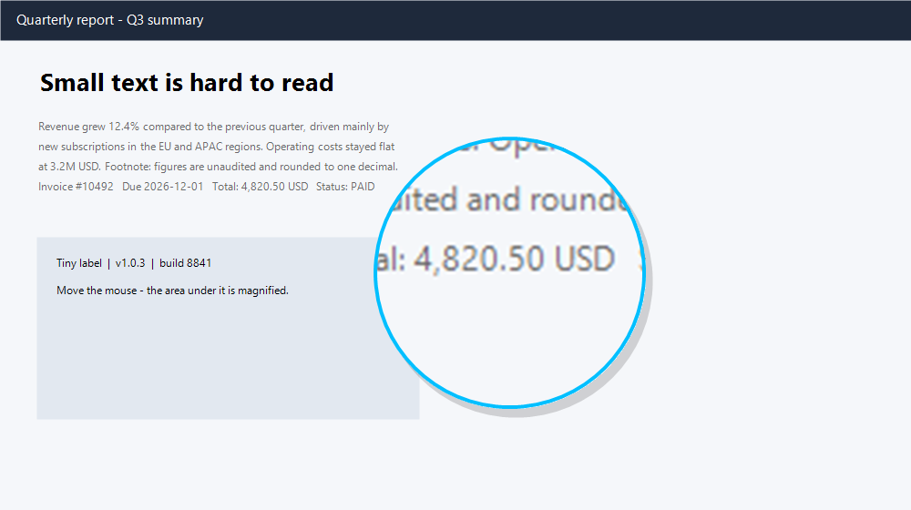

# ZoomLens 🔍

A tiny, free screen magnifier for Windows: a round lens follows your mouse and magnifies whatever is under it.
Toggle it on and off with one hotkey — **Ctrl+Alt+M**.

ذره‌بین سبک و رایگان برای ویندوز: یک لنز گرد دنبال ماوس می‌آید و قسمت زیر ماوس را بزرگ می‌کند.
با یک کلید میانبر (**Ctrl+Alt+M**) باز و بسته می‌شود.



---

## English

### Install (easy)
1. Download **`ZoomLens-Setup.exe`** from the [latest release](../../releases/latest).
2. Run it. If Windows SmartScreen warns you, click **More info → Run anyway** (the file is not code-signed).
3. Done. A `ZoomLens` shortcut is created on the Desktop and in the Start Menu, and the hotkey is active right away and after every login.

Run the installer again at any time to **reinstall** or **uninstall**.

### Use
| Keys | Action |
|---|---|
| `Ctrl+Alt+M` | Open / close the magnifier |
| `Ctrl+Alt+↑` / `Ctrl+Alt+↓` | Zoom in / out (1.5× – 16×) |
| `Ctrl+Alt+Z` | Hide / show the lens |
| `Ctrl+Alt+Q` | Quit |

There is also a tray icon (near the clock): left-click toggles the lens, right-click opens a menu with **Exit**.
The lens is click-through, so you can keep working underneath it.

### How it works
- `ZoomLens.ps1` – the lens (PowerShell + WinForms). It copies a small area around the cursor from the screen and scales it up. The lens window is excluded from screen capture so it doesn't magnify itself.
- `ZoomLens.vbs` – launches the script without a console window.
- `installer/Setup.cs` – the installer. It also contains a tiny hidden host (`ZoomLensHost.exe --hotkey`) that registers the global hotkey with `RegisterHotKey` and starts or stops the lens.

### Requirements
Windows 10 (version 2004 or newer) / Windows 11, with Windows PowerShell 5.1 (included in Windows).

### Build the installer yourself
```powershell
$csc = "$env:WINDIR\Microsoft.NET\Framework64\v4.0.30319\csc.exe"
& $csc -nologo -target:winexe -codepage:65001 -win32icon:ZoomLens.ico -out:ZoomLens-Setup.exe `
  -r:Microsoft.CSharp.dll -r:System.Windows.Forms.dll `
  -resource:ZoomLens.ps1,ZoomLens.ps1 -resource:ZoomLens.vbs,ZoomLens.vbs -resource:ZoomLens.ico,ZoomLens.ico `
  installer\Setup.cs
```

### Troubleshooting
- **Hotkey does nothing:** another program may already use `Ctrl+Alt+M` (the host shows a warning in that case). Check `%LOCALAPPDATA%\ZoomLens\host.log`.
- **First open takes 2–3 seconds:** that is PowerShell starting up. Closing is instant.

---

## فارسی

### نصب (آسان)
۱. فایل **`ZoomLens-Setup.exe`** را از [آخرین Release](../../releases/latest) دانلود کنید.
۲. اجرایش کنید. اگر ویندوز هشدار SmartScreen داد، روی **More info ← Run anyway** بزنید (فایل امضای دیجیتال ندارد).
۳. تمام! شورتکات `ZoomLens` روی دسکتاپ و Start Menu ساخته می‌شود و کلید میانبر هم همان لحظه و بعد از هر بار روشن شدن ویندوز فعال است.

برای **نصب مجدد** یا **حذف**، دوباره نصب‌کننده را اجرا کنید.

### استفاده
| کلید | کار |
|---|---|
| `Ctrl+Alt+M` | باز / بسته کردن ذره‌بین |
| `Ctrl+Alt+↑` / `Ctrl+Alt+↓` | زوم بیشتر / کمتر (۱.۵ تا ۱۶ برابر) |
| `Ctrl+Alt+Z` | مخفی / نمایش لنز |
| `Ctrl+Alt+Q` | خروج کامل |

یک آیکون کنار ساعت (System Tray) هم هست: کلیک چپ لنز را نمایش/مخفی می‌کند و راست‌کلیک منوی **خروج** را باز می‌کند.
لنز روی ماوس کلیک‌خور نیست و می‌توانید زیرش کار کنید.

### عیب‌یابی
- **کلید کار نمی‌کند:** ممکن است برنامه‌ی دیگری از `Ctrl+Alt+M` استفاده کند (در این حالت هشدار نشان داده می‌شود). فایل `%LOCALAPPDATA%\ZoomLens\host.log` را ببینید.
- **بار اول ۲ تا ۳ ثانیه طول می‌کشد:** مربوط به بالا آمدن PowerShell است؛ بستن فوری است.

---

## License
MIT — see [LICENSE](LICENSE).
